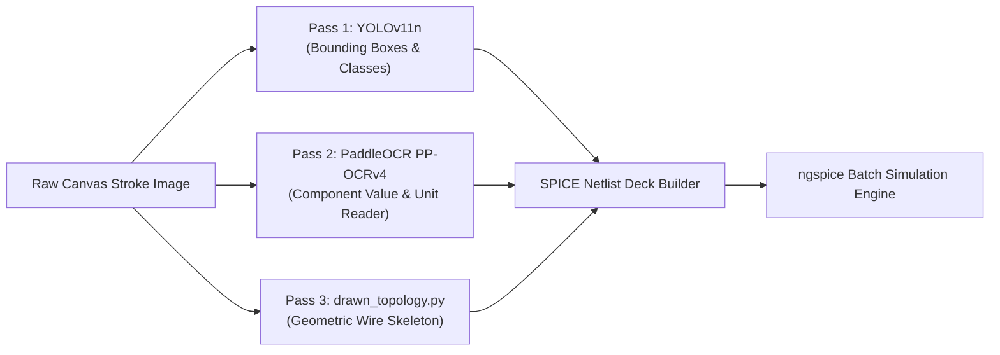
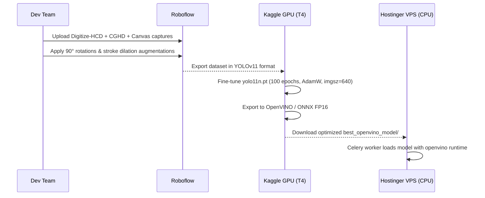

# Production ML Architecture & Model Strategy (College Pilot)

> **Document Objective**: Comprehensive engineering plan for upgrading the circuit detection & parsing engine to production-grade reliability for an entire college deployment (100–300 daily active student submissions) running on an existing Hostinger VPS (4 vCPU / 16 GB RAM) with Cloudflare Pages frontend.

---

## 1. Executive Summary & Goals

| Dimension | Target Specification |
|---|---|
| **Target Scale** | 1 College Deployment (ECE / EEE Lab courses, ~60 concurrent students per batch) |
| **Inference Hardware** | Hostinger VPS (4 vCPU, 16 GB RAM, no discrete GPU) |
| **Target End-to-End Latency** | **< 600 ms** (Canvas draw $\to$ Detection $\to$ OCR $\to$ ngspice result) |
| **Model Detection mAP@50** | **$\ge$ 94.0%** across hand-drawn canvas strokes |
| **Total Cloud Operational Cost** | **< \$30 / month** (VPS + Cloudflare free tier + open-source weights) |

---

## 2. Core Architectural Decisions: "Why This vs. Why Not That"

### A. Model Selection: Why YOLOv11n (Not YOLOv8n, Not YOLOv12n)?

```
┌────────────────────────────────────────────────────────────────────────┐
│                        MODEL COMPARISON MATRIX                         │
├───────────────┬────────────┬─────────────┬─────────────┬───────────────┤
│ Metric        │ YOLOv8n    │ YOLOv11n 🏆 │ YOLOv12n    │ Why for Us?   │
├───────────────┼────────────┼─────────────┼─────────────┼───────────────┤
│ CPU Latency   │ ~35 ms     │ ~38 ms      │ ~110 ms     │ v12 is slow   │
│ Small Detail  │ Moderate   │ High        │ High        │ Attention     │
│ ONNX/OpenVINO │ Stable     │ Rock Solid  │ Fragmented  │ CPU deploy    │
│ RAM footprint │ ~120 MB    │ ~130 MB     │ ~380 MB     │ VPS limits    │
└───────────────┴────────────┴─────────────┴─────────────┴───────────────┘
```

1. **Why NOT YOLOv8n?**  
   Circuit components (resistor zigzags vs inductor loops vs diode bars) differ by tiny, subtle line details. YOLOv8n lacks spatial attention (`C2PSA`), leading to higher misclassification rates between passive components when hand-drawn.
2. **Why NOT YOLOv12n (on CPU)?**  
   YOLOv12 replaces standard convolutions with Area Attention (Transformer blocks). On a dedicated GPU this is great, but on a **4 vCPU Hostinger VPS**, attention calculations cause CPU spikes and 3× higher latency.
3. **Why YOLOv11n is the Sweet Spot:**  
   It introduces **C3k2** feature blocks and lightweight **C2PSA spatial attention**, providing superior small-symbol accuracy with almost zero CPU latency penalty (~38 ms in OpenVINO).

---

### B. Deployment Location: Why VPS Backend (Not In-Browser WebAssembly/ONNX.js)?

* **IP Protection:** Your fine-tuned circuit model and custom topology converter are your core intellectual property. Client-side browser execution allows anyone to inspect DevTools and download your raw `.onnx` model files.
* **Lab Machine Constraints:** Indian engineering college lab computers are frequently older dual-core systems with 4 GB RAM. Running local neural nets in the browser will crash or lag student tabs.
* **Deterministic Environment:** Centralizing inference on the VPS ensures that detection, PaddleOCR, and ngspice execute in a single unified Linux environment.

---

### C. The 3-Pass Architecture: Why Specialized Passes (Not an "All-in-One" Model)?

Trying to make a single model detect components, read handwritten values ("4.7kΩ"), and trace wire connectivity fails in production. We use a **3-pass pipeline**:



1. **Pass 1 — Component Symbol Detection (`recognizer.py` / YOLOv11n):**  
   Detects what components exist and where their bounding boxes lie (~40 ms).
2. **Pass 2 — Value & Unit Extraction (`value_reader.py` / PaddleOCR PP-OCRv4):**  
   Masks out detected component boxes and reads the adjacent text labels ("10k", "5V", "0.1uF") (~250 ms).
3. **Pass 3 — Wire & Junction Topology (`drawn_topology.py`):**  
   A deterministic mathematical tracer (morphology, skeletonization) that maps wire leads to component pins (~15 ms).

---

## 3. Dataset Strategy: The Curated Composite Stack

To eliminate symbol hallucinations across all ECE/EEE lab experiments, the training set will combine three verified sources:

```
Total Curated Dataset: ~3,200 High-Quality Images
├── 1. Digitize-HCD (Mendeley Data) [40% ~ 1,280 images]
│      • 150+ real human handwritings on paper/scans
│      • Pre-annotated in COCO format (17 symbol classes + OCR text labels)
├── 2. CGHD-1152 (Kaggle / Johannes Bayer) [35% ~ 1,120 images]
│      • Benchmark hand-drawn circuits (analog & RLC networks)
├── 3. Roboflow Logic Gates & IC Expansion [15% ~ 500 images]
│      • Digital electronics symbols: AND, OR, NOT, NAND, NOR, XOR
└── 4. In-House Web Canvas Lab Captures [10% ~ 300 images]
       • Real student strokes drawn directly on our web canvas
```

### Roboflow Augmentation Configuration
* **90° Discrete Rotations:** Clockwise & Counter-Clockwise (Horizontal vs. Vertical resistors/capacitors).
* **Line Dilation & Stroke Thickness:** $\pm 1$–$2\text{ px}$ (Simulating thin stylus lines vs. thick marker strokes).
* **Scale / Bounding Box Jitter:** $\pm 15\%$ (Handling small vs. massive drawings).
* **Strict Class Normalization:** Unify all labels to lowercase canonical slugs (`resistor`, `capacitor`, `inductor`, `diode`, `transistor_npn`, `transistor_pnp`, `opamp`, `ground`, `vsource_dc`, `vsource_ac`).

---

## 4. Production ECE Component Syllabus Roadmap

We roll out components grouped by academic lab courses:

```
┌────────────────────────────────────────────────────────────────────────┐
│ Phase 1: Basic Electrical & Network Theory Lab (Current Scope)        │
│ • Resistor, Capacitor, Inductor, DC Source, AC Source, Ground, Switch  │
├────────────────────────────────────────────────────────────────────────┤
│ Phase 2: Analog Electronics / EDC Lab (Next Milestone)                 │
│ • Diodes (Rectifier, Zener, LED)                                       │
│ • Transistors (BJT NPN, BJT PNP, N-Channel MOSFET)                     │
│ • Op-Amps (LM741 3-terminal & 5-terminal configurations)              │
├────────────────────────────────────────────────────────────────────────┤
│ Phase 3: Digital Electronics & IC Lab                                  │
│ • Logic Gates (AND, OR, NOT, NAND, NOR, XOR)                           │
│ • 555 Timer IC & Basic Flip-Flops                                      │
└────────────────────────────────────────────────────────────────────────┘
```

---

## 5. Training, Optimization & Deployment Workflow



### Free Training Script for Kaggle (Zero Cloud Cost)

```python
!pip install ultralytics roboflow

from ultralytics import YOLO
from roboflow import Roboflow

# 1. Download dataset from Roboflow
rf = Roboflow(api_key="YOUR_ROBOFLOW_API_KEY")
project = rf.workspace("circuit-sim").project("ece-production-v1")
version = project.version(1)
dataset = version.download("yolov11")

# 2. Train YOLOv11n on Kaggle Free Tesla T4 GPU (~20 mins)
model = YOLO("yolo11n.pt")
model.train(
    data=f"{dataset.location}/data.yaml",
    epochs=100,
    imgsz=640,
    batch=16,
    optimizer="AdamW",
    device=0
)

# 3. Export to OpenVINO for Hostinger VPS CPU inference
model.export(format="openvino", half=True)
```

---

## 6. Hostinger VPS Resource Allocation (4 vCPU / 16 GB RAM)

To guarantee that 60 students submitting simultaneously do not crash the VPS:

* **FastAPI Server (Uvicorn):** 2 worker processes (~300 MB RAM total).
* **Celery Inference Queue:** 2 worker processes max (`--concurrency=2`).
  * *Worker 1:* YOLOv11n OpenVINO inference.
  * *Worker 2:* PaddleOCR inference.
* **CPU Core Allocation:** 2 cores dedicated to inference queues; 2 cores preserved for OS, ngspice SPICE solvers, and Nginx.
* **ngspice Safety Guard:** 3-second timeout per simulation thread to prevent ill-conditioned circuits from locking up CPU threads.

---

## 7. Immediate Team Next Steps

1. [ ] **Download Mendeley Digitize-HCD dataset** (`https://data.mendeley.com/datasets/rngcz5wtv8/1`).
2. [ ] **Create Roboflow workspace** and merge Mendeley + CGHD-1152 with unified label mappings.
3. [ ] **Gather 100 canvas drawings** from college peers using the React frontend drawing pad.
4. [ ] **Train `yolo11n.pt` on Kaggle** using the script above.
5. [ ] **Convert output weights to OpenVINO** and drop into `backend/model/circuit_detector_best/`.
6. [ ] **Run end-to-end benchmark** measuring latency and accuracy on sample ECE circuits.

